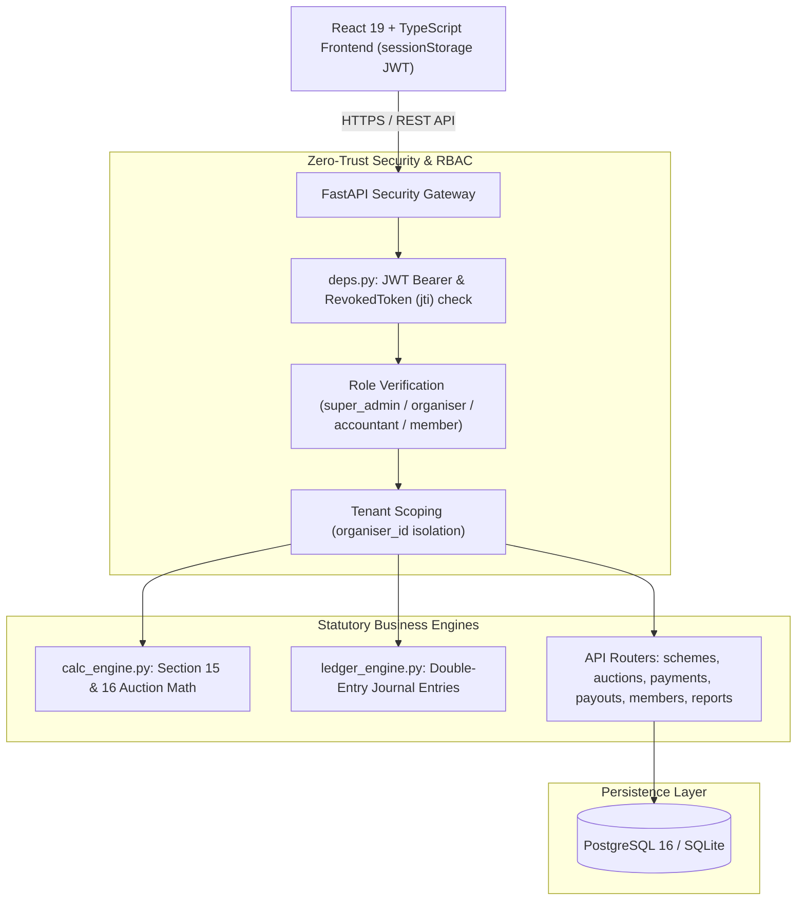
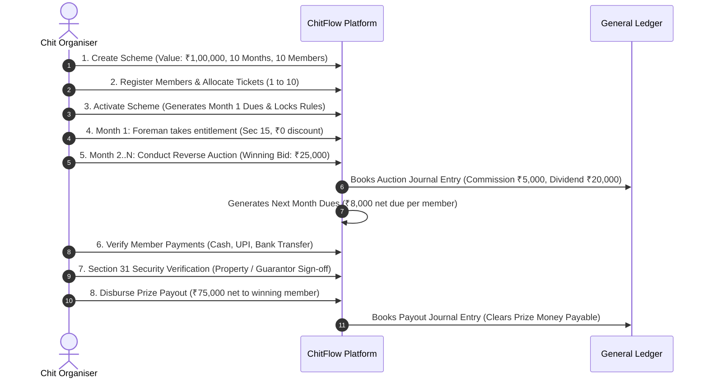

# ChitFlow — Statutory Chit Fund Management System

[](https://github.com/Sankeerth28/ChitFlow/actions/workflows/ci.yml)
[](https://fastapi.tiangolo.com)
[](https://react.dev)
[](https://www.python.org/)
[](LICENSE)
[-success.svg)](backend/tests/)

> *"Every Chit. Every Member. Every Rupee. Accounted For."*

**ChitFlow** is a modern, transparent, and mathematically deterministic chit fund management platform built in strict adherence to the **Chit Funds Act, 1982**, the **Chit Funds (Amendment) Act, 2019**, and the **Telangana Chit Funds Rules, 2008**.

It digitizes the complete operational lifecycle of registered chit fund companies: scheme registration, member ticket allocation, monthly reverse auctions, automated dividend distribution, collection receipts, statutory security verification (Section 31), prize disbursements, and real-time double-entry general ledger accounting.

---

## 📑 Table of Contents

- [1. Core Capabilities](#1-core-capabilities)
- [2. System Architecture](#2-system-architecture)
- [3. How to Use the Application](#3-how-to-use-the-application)
  - [3.1 Quick Demo Login (Dev / QA Mode)](#31-quick-demo-login-dev--qa-mode)
  - [3.2 Organiser (Foreman) Workflow](#32-organiser-foreman-workflow)
  - [3.3 Member (Subscriber) Workflow](#33-member-subscriber-workflow)
  - [3.4 Accountant Workflow](#34-accountant-workflow)
  - [3.5 Super Administrator Workflow](#35-super-administrator-workflow)
- [4. Statutory Financial Engine](#4-statutory-financial-engine)
- [5. Getting Started Locally](#5-getting-started-locally)
- [6. Running the Automated Test Suite](#6-running-the-automated-test-suite)
- [7. Production Deployment](#7-production-deployment)
- [8. Repository Structure](#8-repository-structure)
- [9. Regulatory Compliance & Security](#9-regulatory-compliance--security)

---

## 1. Core Capabilities

- **Deterministic Calculation Engine**: Implements exact financial calculations with zero floating-point imprecision using Python `Decimal`. Enforces the statutory 5% foreman commission and 30% discount ceiling.
- **Automated Dividend Distribution**: Automatically calculates member dividend pool discounts and routes fractional rounding residuals into statutory suspense accounts so `Total Collections = Chit Value`.
- **Real-Time Double-Entry General Ledger**: Books balanced, immutable journal entries (Event 1: Auction Finalization, Event 2: Payment Receipt, Event 4: Prize Payout) with real-time Trial Balance verification (`sum(Debits) == sum(Credits)`).
- **Member 10-Second Dashboard**: Subscribers can check their active chit value, next monthly due date, net amount payable (after dividend discount), and prized payout status in under 10 seconds.
- **Section 31 Statutory Security Guard**: Prevents release of prize money until the foreman records and validates approved subscriber collateral.
- **Multi-Tenant Data Isolation**: Complete logical and relational segregation across independent chit organisations with zero-trust IDOR defenses.

---

## 2. System Architecture



---

## 3. How to Use the Application

### 3.1 Quick Demo Login (Dev / QA Mode)

When running locally or in development mode, the interactive login screen features **one-click quick-fill buttons** for testing all 4 system roles:

| Role | Username / Mobile | Password | Capabilities & Access |
| :--- | :--- | :--- | :--- |
| **Chit Organiser** | `9849012345` | `OrganiserPassword123!` | Complete operational control: create schemes, activate auctions, confirm bids, verify security, disburse payouts. |
| **Subscriber (Member)** | `9876543201` | `MemberPassword123!` | Personal portal: view 10-second dashboard, check monthly dues, submit payment proofs, submit auction bids. |
| **Accountant / Staff** | `9849012346` | `AccountantPassword123!` | Financial back-office: verify member payments, inspect collections, audit double-entry Trial Balance. |
| **Super Administrator** | `9999999999` | `AdminPassword123!` | Platform-level management: monitor platform health. *Strictly barred from altering financial records.* |

---

### 3.2 Organiser (Foreman) Workflow

The Chit Organiser is the licensed operator managing chit groups:



#### Step-by-Step Instructions:
1. **Create a Chit Scheme**:
   - Navigate to the **Schemes** tab and click **Create New Scheme**.
   - Fill in: Scheme Code (e.g., `SB-01`), Chit Value (e.g., `100000`), Duration in Months (`10`), Total Members (`10`), Monthly Subscription (`10000`), Due Day (`5th`), and Auction Day (`10th`).
   - Click **Create Scheme**.
2. **Register Members & Allocate Tickets**:
   - Go to **Members** and register subscribers (Name, Mobile, Address, KYC status).
   - In your scheme details, allocate Ticket numbers (`1` to `N`) to enrolled members.
3. **Activate the Scheme**:
   - Once all `N` tickets are enrolled, click **Activate Scheme**.
   - *Automated Action*: Locks scheme parameters permanently, schedules all `N` monthly auctions, and automatically generates Month 1 subscription dues for every subscriber.
4. **Conduct Monthly Auctions**:
   - On the auction date, open the scheduled auction.
   - Enter the winning subscriber and the winning auction discount bid (e.g., ₹25,000).
   - Click **Confirm Auction**.
   - *Automated Action*: Calculates foreman commission (5%), member dividend pool, individual member dividend credit (e.g., ₹2,222.22), creates the prize payout record, writes balanced double-entry journal entries, and generates Month $M+1$ dues for all members.
5. **Verify Member Payments**:
   - Go to **Payments & Receipts** to see submitted subscriber payments.
   - Click **Verify Payment** (Cash, UPI, Bank Transfer). The instalment is marked `paid` and the cash/bank ledger account is credited.
6. **Section 31 Security & Prize Disbursement**:
   - Under **Payouts**, open the prized subscriber's record.
   - Complete Section 31 statutory sign-off (e.g., Bank Guarantee, Surety, Title Deed).
   - Click **Disburse Payout** with the bank transaction reference number.

---

### 3.3 Member (Subscriber) Workflow

Subscribers enjoy a clean, self-service dashboard to manage their chit savings:

1. **The 10-Second Dashboard**:
   - Logging in as a member immediately surfaces:
     - **Active Scheme Name & Ticket Number**.
     - **Next Payment Due Date** and **Net Amount Due** (subscription minus your dividend discount).
     - **Total Dividends Earned to Date**.
     - **Prize Money Status** (Prized vs Non-Prized).
2. **Paying Instalments**:
   - Under **My Instalments**, view pending and past monthly dues.
   - Click **Submit Payment Proof** to upload UPI reference IDs or transaction details.
3. **Bidding in Monthly Auctions**:
   - Go to **Active Auctions**.
   - Non-prized members can submit competitive bids up to the statutory 30% discount limit.

---

### 3.4 Accountant Workflow

Staff accountants handle back-office reconciliations:
- **Receipt Verification**: Audit incoming payment proofs and approve collections.
- **Financial Statements**: Access real-time **Trial Balance** (`/reports/trial-balance`) showing asset, liability, equity, revenue, and expense balances with guaranteed zero-variance balancing.

---

### 3.5 Super Administrator Workflow

Platform administrators maintain platform infrastructure and organization accounts. Under the Chit Funds Act, **super administrators are strictly barred from modifying financial entries or inspecting private subscriber dashboards**.

---

## 4. Statutory Financial Engine

The calculation engine in [`backend/app/core/calc_engine.py`](backend/app/core/calc_engine.py) implements the statutory formulas:

$$\text{Foreman Commission} = V \times 5\%$$

$$\text{Member Dividend Pool} = D - \text{Foreman Commission}$$

$$\text{Dividend Per Member} = \left\lfloor \frac{\text{Member Dividend Pool}}{N - 1} \right\rfloor$$

$$\text{Net Monthly Due} = S - \text{Dividend Per Member}$$

Where:
- $V$ = Gross Chit Value (e.g., ₹1,00,000)
- $D$ = Winning Auction Discount Bid (e.g., ₹25,000)
- $N$ = Total Subscribers in Group (e.g., 10)
- $S$ = Monthly Contribution (e.g., ₹10,000)

*Fractional residuals (paise) are rounded down and credited to `Rounding Suspense Account`, ensuring the ledger always balances to the exact rupee.*

---

## 5. Getting Started Locally

### Prerequisites
- **Python**: Version 3.10 or 3.11
- **Node.js**: Version 18 or 20+
- **Git**

### Step 1: Clone the Repository
```bash
git clone https://github.com/Sankeerth28/ChitFlow.git
cd ChitFlow
```

### Step 2: Backend Setup
```bash
# Windows PowerShell
python -m venv backend\.venv
backend\.venv\Scripts\Activate.ps1
pip install -r backend\requirements.txt

# Linux / macOS
python3 -m venv backend/.venv
source backend/.venv/bin/activate
pip install -r backend/requirements.txt
```

Launch the FastAPI backend:
```bash
# From workspace root
uvicorn app.main:app --app-dir backend --reload --port 8000
```
*API Swagger Documentation will be available at [http://localhost:8000/docs](http://localhost:8000/docs).*

### Step 3: Frontend Setup
In a new terminal:
```bash
cd frontend
npm install
npm run dev
```
*Open [http://localhost:5173](http://localhost:5173) in your browser.*

---

## 6. Running the Automated Test Suite

ChitFlow includes **29 automated tests** covering financial algorithms, double-entry accounting invariants, tenant isolation, and security controls:

```powershell
# Windows PowerShell
$env:PYTHONPATH='backend'; python -m unittest discover -s backend/tests

# Linux / macOS
PYTHONPATH=backend python3 -m unittest discover -s backend/tests
```

```text
Ran 29 tests in 17.287s - OK
```

### Test Suite Breakdown
- `test_calc_engine.py` (7 tests): Validates statutory commissions, 30% bid caps, and fractional rounding.
- `test_ledger_engine.py` (5 tests): Verifies balanced debit/credit invariants on all journal entries.
- `test_api_integration.py` (1 test): Complete end-to-end lifecycle simulation (enrollment, auction, dues, payouts).
- `test_auth_rbac.py` (10 tests): Audits JWT validity, role permissions, and token revocation.
- `test_security_verification.py` (6 tests): Validates 72-byte password limits, fail-secure boot guards, and tenant boundaries.

---

## 7. Production Deployment

ChitFlow is production-ready for Docker and Cloud PaaS:

### Option A: Docker Compose (Full Stack)
```bash
cp .env.example .env
# Edit .env with your production SECRET_KEY and DB_PASSWORD
docker compose up -d --build
```

### Option B: Render.com (1-Click Blueprint)
ChitFlow contains a native [`render.yaml`](render.yaml) blueprint:
1. Connect `https://github.com/Sankeerth28/ChitFlow` to [Render Blueprints](https://dashboard.render.com/blueprints).
2. Automatically provisions Managed PostgreSQL (`chitflow-db`), Python Gunicorn API (`chitflow-api`), and React Global CDN (`chitflow-web`).

*For detailed cloud configuration, SSL setup, and backup scripts, see [DEPLOYMENT.md](DEPLOYMENT.md).*

---

## 8. Repository Structure

```text
ChitFlow/
├── .github/workflows/          # GitHub Actions CI/CD pipeline (automated tests & build)
├── backend/
│   ├── app/
│   │   ├── api/v1/             # REST endpoints (auth, schemes, auctions, payments, payouts, members, reports)
│   │   ├── core/               # Math engine (calc_engine), ledger (ledger_engine), security (security.py)
│   │   ├── db/                 # SQLAlchemy session & PostgreSQL normalization
│   │   ├── models/             # Relational entities (ChitScheme, Member, Auction, Payment, etc.)
│   │   └── schemas/            # Pydantic validation schemas
│   ├── tests/                  # 29 automated test suites
│   ├── Dockerfile              # Hardened multi-stage Python 3.10-slim runner
│   ├── gunicorn_conf.py        # Multi-worker Uvicorn process manager
│   └── requirements.txt        # Backend dependencies
├── frontend/
│   ├── src/
│   │   ├── api/                # API clients & sessionStorage token management
│   │   ├── App.tsx             # Interactive application UI & role views
│   │   └── main.tsx            # Vite React entrypoint
│   ├── Dockerfile              # Multi-stage Node build + Alpine Nginx web server
│   ├── nginx.conf              # SPA fallback & HTTP security headers
│   └── package.json            # Frontend dependencies
├── .env.example                # Safe production environment variable template
├── .gitignore                  # Ironclad git exclusion rules
├── DEPLOYMENT.md               # Production operations manual
├── docker-compose.yml          # Local and production multi-container orchestration
└── render.yaml                 # Render.com Blueprint configuration
```

---

## 9. Regulatory Compliance & Security

- **Chit Funds Act, 1982 (Act No. 40 of 1982)**: Strict compliance with Sections 15 (Foreman entitlement), 16 (Auction limits), 30 (Maintenance of registers), and 31 (Subscriber security).
- **Password Security**: Direct 12-round salted `bcrypt` with explicit rejection of inputs exceeding 72 bytes.
- **Session Security**: Stateless JWT access tokens pinned to `HS256` with server-side `RevokedToken` table for instantaneous session invalidation on logout.
- **Fail-Secure Boot Guard**: In `production`, the system refuses to boot if `SECRET_KEY` is missing or matches development placeholders.

---

## 📄 License

This software and its custom deterministic calculation algorithms are proprietary and confidential.  
© 2026 ChitFlow Technologies. All rights reserved.

