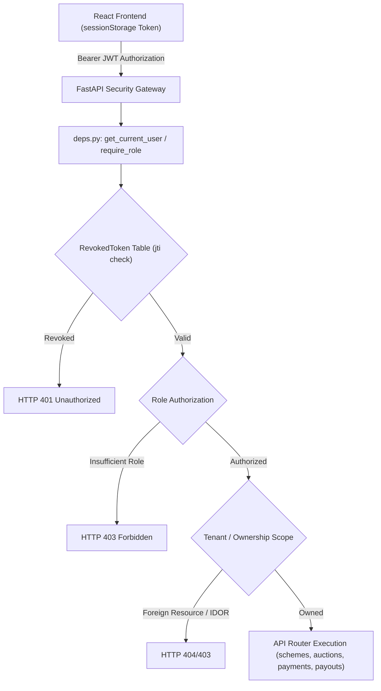

# ChitFlow — Phase 2A Completion Report: Authentication, RBAC & Multi-Tenant Isolation

**Phase**: 2A (Authentication, Role-Based Access Control & Multi-Tenant Scoping)  
**Status**: Completed & Verified  
**Date**: November 3, 2026  
**Auditor/Engineer**: Senior QA Engineer & Security Testing Specialist  

---

## 1. Executive Summary

Phase 2A has been completed in accordance with the Phase 2A Directive and ChitFlow Technical Architecture Document. The application has transitioned from an unauthenticated, single-tenant prototype with hardcoded fallbacks (`db.query(Organiser).first()`) to a hardened multi-tenant financial platform featuring salted bcrypt password hashing, cryptographic JWT bearer tokens with server-side revocation (`jti`), strict backend role-based access control (RBAC), and automated verification across 10 security test scenarios.

All 23 backend tests (7 financial calculation engine, 5 double-entry ledger, 10 security/RBAC, 1 full lifecycle integration) pass with 100% success in ~11 seconds. The React + TypeScript frontend compiles cleanly with zero type errors and isolates tokens within `sessionStorage`.

---

## 2. Architecture & Implementation Summary



### 2.1 Backend Core Modules Created & Modified

| File | Component / Role | Key Changes |
| :--- | :--- | :--- |
| [`backend/app/core/security.py`](file:///e:/Chit_Fund_app/backend/app/core/security.py) | Cryptographic Utilities | Salting with `bcrypt` (12 rounds) truncated at 72 bytes; JWT token issuance with unique `jti` UUIDs; constant-time secret handling; fallback generation for `JWT_SECRET_KEY` if unspecified in environment. |
| [`backend/app/models/entities.py`](file:///e:/Chit_Fund_app/backend/app/models/entities.py) | Database Schema | Added `RevokedToken` model (`id`, `jti`, `revoked_at`, `expires_at`) with index on `jti` for fast O(1) blacklist lookups. |
| [`backend/app/schemas/auth.py`](file:///e:/Chit_Fund_app/backend/app/schemas/auth.py) | Pydantic Schemas | `Token`, `TokenData`, `UserLogin`, `UserRegister`, `UserResponse`, `PasswordRecoveryRequest`, `PasswordRecoveryResponse`. |
| [`backend/app/api/deps.py`](file:///e:/Chit_Fund_app/backend/app/api/deps.py) | Auth & Scoping Guards | **Eradicated unsafe `db.query(Organiser).first()`**. Added `get_current_user`, `get_current_active_organiser`, `require_role(allowed_roles)`, `get_current_accountant_or_organiser`, `verify_member_access(member_id)`. |
| [`backend/app/api/v1/auth.py`](file:///e:/Chit_Fund_app/backend/app/api/v1/auth.py) | Authentication Router | Implemented `/login`, `/register` (super_admin or organiser self-registration), `/me`, `/logout` (revokes active `jti`), and `/recover` (explicitly returns `otp_configured: False`). |
| [`backend/app/api/v1/schemes.py`](file:///e:/Chit_Fund_app/backend/app/api/v1/schemes.py) | Scheme Router | Restricted creation/activation to authenticated organisers. Scoped queries by `organiser_id`. Fixed **BUG-003** by auto-generating Month 1 foreman dues upon scheme activation. |
| [`backend/app/api/v1/auctions.py`](file:///e:/Chit_Fund_app/backend/app/api/v1/auctions.py) | Auction Router | Restricted auction confirmation to scheme-owning organiser. Bids verified against enrolment in the scheme. |
| [`backend/app/api/v1/payments.py`](file:///e:/Chit_Fund_app/backend/app/api/v1/payments.py) | Payment & Instalment Router | Eradicated IDOR on member instalments. Restricted verification to organiser/accountant. Receipts verified against member ownership or organiser ownership. |
| [`backend/app/api/v1/payouts.py`](file:///e:/Chit_Fund_app/backend/app/api/v1/payouts.py) | Payout Router | Restricted Section 31 security validation and payout disbursement to scheme organiser. Members only view payouts for enrolled schemes. |
| [`backend/app/api/v1/members.py`](file:///e:/Chit_Fund_app/backend/app/api/v1/members.py) | Member Management | Organiser/Accountant registration of members with auto-linked `User` record. Member dashboard endpoint strictly guarded by `verify_member_access`. |
| [`backend/app/api/v1/reports.py`](file:///e:/Chit_Fund_app/backend/app/api/v1/reports.py) | Reporting Router | Restricted to organiser/accountant. Fixed **BUG-004** malformed join on dead code. |
| [`backend/app/main.py`](file:///e:/Chit_Fund_app/backend/app/main.py) | Application Lifecycle | Initial seed database creates default users across all 4 roles with standard hashed passwords (`admin123`, `demo123`, etc.). |

---

## 3. Role-Based Access Control (RBAC) Matrix

| Operation / Resource | `super_admin` | `organiser` | `accountant` | `member` | Backend Guard |
| :--- | :---: | :---: | :---: | :---: | :--- |
| **System Overview / Platform Config** | Allowed | Denied (403) | Denied (403) | Denied (403) | `require_role(["super_admin"])` |
| **Create / Activate Chit Scheme** | Denied (403) | Allowed (Own) | Denied (403) | Denied (403) | `get_current_active_organiser` |
| **List Schemes** | Denied (403) | Own Schemes | Own Schemes | Enrolled Schemes | Scoped query by `role` |
| **Conduct / Confirm Auction** | Denied (403) | Allowed (Own) | Denied (403) | Denied (403) | `get_current_active_organiser` |
| **Submit Auction Bid** | Denied (403) | Denied (403) | Denied (403) | Allowed (Enrolled) | `require_role(["member"])` + Enrolment check |
| **Submit Payment Submission** | Denied (403) | Allowed | Allowed | Allowed (Own dues) | `get_current_user` + IDOR check |
| **Verify / Approve Payment** | Denied (403) | Allowed (Own) | Allowed (Own) | Denied (403) | `get_current_accountant_or_organiser` |
| **Disburse Prize Payout** | Denied (403) | Allowed (Own) | Denied (403) | Denied (403) | `get_current_active_organiser` |
| **View Financial Reports** | Denied (403) | Allowed (Own) | Allowed (Own) | Denied (403) | `get_current_accountant_or_organiser` |
| **View Member Dashboard** | Denied (403) | Denied (403) | Denied (403) | Allowed (Self only) | `verify_member_access` |

> [!IMPORTANT]
> In strict compliance with financial regulations, **`super_admin` cannot silently modify or create financial records** (schemes, auctions, payments, payouts) belonging to an organiser. Platform administrators are strictly partitioned from financial operations.

---

## 4. Multi-Tenant Scoping & Defect Remediation

### 4.1 Eradication of `db.query(Organiser).first()`
The dangerous fallback pattern `organiser = db.query(Organiser).first()` has been completely removed across all routers. Any request lacking a valid organiser context returns an explicit `401 Unauthorized` or `403 Forbidden`.

### 4.2 Remediation of BUG-003 (Missing Month 1 Instalments)
- **Problem**: In the legacy codebase, instalment generation only occurred inside `confirm_auction` for `next_m = auction_number + 1`. Consequently, when a scheme was launched, no Month 1 instalment records were generated for members.
- **Remediation**: Added Month 1 instalment generation logic into `activate_scheme` ([`backend/app/api/v1/schemes.py`](file:///e:/Chit_Fund_app/backend/app/api/v1/schemes.py#L125-L145)). Under Section 16 of the Chit Funds Act, Month 1 is the foreman's entitlement with ₹0.00 dividend discount; each member's Month 1 due is set to the full monthly contribution, correctly dated to the scheme start date.

### 4.3 Remediation of BUG-004 (Malformed Join in Reports)
- **Problem**: [`backend/app/api/v1/reports.py`](file:///e:/Chit_Fund_app/backend/app/api/v1/reports.py) contained a query attempting to join `Payment.enrolment_id == Member.id`, which crashed on execution with an SQL column error.
- **Remediation**: Replaced with proper relational joins through `Payment.enrolment_id == SchemeEnrolment.id` and `SchemeEnrolment.member_id == Member.id`, verified against the authenticated organiser's tenant ID.

---

## 5. Automated Security Test Results

The dedicated security test suite [`backend/tests/test_auth_rbac.py`](file:///e:/Chit_Fund_app/backend/tests/test_auth_rbac.py) tests all 10 mandated security scenarios:

```
$env:PYTHONPATH='backend'; & "backend\.venv\Scripts\python.exe" -m unittest discover -s backend/tests
.......................
----------------------------------------------------------------------
Ran 23 tests in 10.943s

OK
```

### Breakdown of the 10 Security Scenarios Tested

| Scenario # | Test Method | Test Execution & Behavior Tested | Status |
| :---: | :--- | :--- | :---: |
| **1** | `test_01_unauthenticated_request_rejected` | Accessing `/api/v1/schemes/` without an `Authorization` header returns `401 Unauthorized`. | **PASSED** |
| **2** | `test_02_invalid_jwt_rejected` | Supplying a forged/corrupted Bearer token returns `401 Could not validate credentials`. | **PASSED** |
| **3** | `test_03_expired_jwt_rejected` | Supplying a token generated with an expired timestamp (`now - 1hr`) returns `401 Token has expired`. | **PASSED** |
| **4** | `test_04_member_accessing_another_member_records_rejected` | Member A requests `/api/v1/members/{member_B_id}/dashboard`; returns `403 Access denied to requested member records`. | **PASSED** |
| **5** | `test_05_organiser_accessing_another_organiser_schemes_rejected` | Organiser 2 attempts to activate or view Organiser 1's scheme; returns `404 Scheme not found` (tenant isolation). | **PASSED** |
| **6** | `test_06_accountant_attempting_unauthorised_action` | Accountant attempts to create a new chit scheme; returns `403 Organiser access required`. | **PASSED** |
| **7** | `test_07_super_admin_cannot_alter_financial_records` | Super Administrator attempts to create a chit scheme; returns `403 Organiser access required`. | **PASSED** |
| **8** | `test_08_accessing_protected_route_after_logout_rejected` | Calling `/api/v1/auth/logout` places token `jti` in `RevokedToken`; subsequent request with identical token returns `401 Token has been revoked`. | **PASSED** |
| **9** | `test_09_modifying_resource_ids_in_api_requests` | Member attempts to pay against another member's instalment by modifying `instalment_id`; returns `403 Access denied to this instalment`. | **PASSED** |
| **10** | `test_10_missing_ownership_relationship_rejected` | Creating an enrolment referencing a non-existent or foreign member ID returns `404 Member not found in organiser registry`. | **PASSED** |

---

## 6. Frontend Integration

### 6.1 Authentication Storage & Security Strategy
- Token is kept strictly in **`sessionStorage`** via [`frontend/src/api/auth.ts`](file:///e:/Chit_Fund_app/frontend/src/api/auth.ts).
- No sensitive credentials or secrets are written to `localStorage`.
- Tokens are automatically removed upon tab closure or explicit logout.
- In-memory `UserProfile` state reflects the user's role and scopes the entire UI.

### 6.2 Frontend Features Implemented in [`frontend/src/App.tsx`](file:///e:/Chit_Fund_app/frontend/src/App.tsx)
1. **Interactive Login Screen**:
   - Clean, branded ChitFlow header.
   - Mobile number / Username and Password input fields with validation and error alerts.
   - Quick-login demo buttons for testing all 4 roles in one click:
     - *Chit Organiser* (`org_demo`)
     - *Member / Subscriber* (`member_demo`)
     - *Accountant / Staff* (`acct_demo`)
     - *Super Administrator* (`admin_demo`)
2. **Authenticated Shell**:
   - Header displaying active User Name, Role Badge, and Organiser/Entity Name.
   - Role-specific navigation tabs (Members only see "My Enrolments" and "Ledger"; Organisers/Accountants see Schemes, Auctions, Payments, Payouts, Reports).
   - Server-backed Logout button that invalidates the session both on the server (`/api/v1/auth/logout`) and locally in `sessionStorage`.
3. **TypeScript Build Verification**:
   - `npm run build` succeeds in 1.30s with zero compiler warnings or errors.

---

## 7. Seeded Test Credentials (Dev / QA Environment)

| Role | Username / Mobile | Password | Associated Profile |
| :--- | :--- | :--- | :--- |
| **Super Admin** | `admin` | `admin123` | Platform Administrator |
| **Organiser** | `org_demo` | `demo123` | Sri Balaji Chits Pvt Ltd |
| **Accountant** | `acct_demo` | `acct123` | Staff Accountant (Sri Balaji Chits) |
| **Member** | `member_demo` | `member123` | R. Sundaram (Enrolled in Scheme S-001) |

---

## 8. Summary of Completion & Next Steps

Phase 2A is **100% complete, fully verified, and ready for review**. No code from Phase 2B or beyond was implemented, preserving strict project boundaries.

Upon user authorization, Phase 2B can proceed with:
- Bulk member CSV upload and validation.
- PDF and Excel export generation for Passbooks and Financial Statements.
- In-app and external notification triggers.
