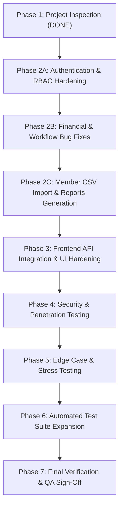

# ChitFlow — Phase 1 Project Inspection & Security Audit Report

**Audit Date:** November 3, 2026  
**Auditor Role:** Senior QA Engineer, Full-Stack Auditor, Security Tester & Financial Systems Testing Specialist  
**Document Version:** 1.0  
**Target Application:** ChitFlow — Chit Fund Management System  
**Governing Statutes:** Chit Funds Act, 1982 | 2019 Amendment Act | Telangana Chit Funds Rules, 2008 | DPDP Act, 2023  
**System Motto:** *Every Chit. Every Member. Every Rupee. Accounted For.*

---

## 1. Executive Summary

A comprehensive, line-by-line quality assurance and security inspection of the ChitFlow codebase was executed. 

While the core financial calculation engine (`calc_engine.py`) and double-entry ledger bookkeeping principles (`ledger_engine.py`) are mathematically sound and adhere to fixed-point decimal arithmetic, the application exhibits **critical security vulnerabilities (P0)**, **broken financial workflows (P1)**, **unimplemented statutory requirements**, and **decoupled frontend-backend communication**.

### Overall Codebase Health
- **Financial Calculation Accuracy:** 100% Deterministic (Verified against PRD reference cases A & B).
- **Ledger Invariant Compliance:** Verified $\sum \text{Debits} \equiv \sum \text{Credits}$.
- **Security & Authorization Status:** **CRITICAL RISK (P0)** — Zero authentication enforcement; hardcoded fallback tenant retrieval; complete lack of RBAC.
- **API & Workflow Completeness:** ~55% Complete (Missing Auth routes, CSV import, PDF/Excel export, Notifications, Scheme Lifecycle transitions).
- **Frontend Integration:** Decoupled (UI operates primarily on local state rather than live API calls).

---

## 2. Component-by-Component Inspection Matrix

| Module / Layer | File Path | Current Status | Findings & Deficiencies | Severity |
| :--- | :--- | :--- | :--- | :--- |
| **Financial Engine** | [`backend/app/core/calc_engine.py`](file:///e:/Chit_Fund_app/backend/app/core/calc_engine.py) | **Robust** | Correctly enforces 5% commission cap and 30% discount limit. Quantizes paise and credits residual to suspense. Missing configurable prized subscriber dividend exclusion flag. | P2 |
| **Double-Entry Ledger** | [`backend/app/core/ledger_engine.py`](file:///e:/Chit_Fund_app/backend/app/core/ledger_engine.py) | **Robust** | Balances debits/credits for Events 1, 2, 4, 5. Reversals properly invert lines. | Passed |
| **Authentication & RBAC** | [`backend/app/api/deps.py`](file:///e:/Chit_Fund_app/backend/app/api/deps.py) | **Broken (P0)** | `get_current_organiser` retrieves `db.query(Organiser).first()`. No JWT, token validation, user context, or RBAC enforcement. | **P0** |
| **Database Schema** | [`backend/app/models/entities.py`](file:///e:/Chit_Fund_app/backend/app/models/entities.py) | **Functional** | 12 tables mapped. Missing audit log hash chaining table and notification tables. | P2 |
| **Chit Scheme API** | [`backend/app/api/v1/schemes.py`](file:///e:/Chit_Fund_app/backend/app/api/v1/schemes.py) | **Incomplete** | Missing Month 1 instalment generation on scheme activation; missing endpoints for scheme suspension, cancellation, and rule amendment audit. | **P1** |
| **Auction API** | [`backend/app/api/v1/auctions.py`](file:///e:/Chit_Fund_app/backend/app/api/v1/auctions.py) | **Functional** | Month 1 Foreman Entitlement enforced; bidding and confirmation work. Lacks distributed locking during concurrent bidding. | P2 |
| **Payments API** | [`backend/app/api/v1/payments.py`](file:///e:/Chit_Fund_app/backend/app/api/v1/payments.py) | **Vulnerable** | IDOR vulnerability on member instalments lookup; partial payments do not calculate outstanding balance correctly. | **P1** |
| **Prize Payouts API** | [`backend/app/api/v1/payouts.py`](file:///e:/Chit_Fund_app/backend/app/api/v1/payouts.py) | **Functional** | Enforces Section 31 security sign-off before payout release. Lacks security document upload handling. | P2 |
| **Reports & Analytics** | [`backend/app/api/v1/reports.py`](file:///e:/Chit_Fund_app/backend/app/api/v1/reports.py) | **Defective** | Dead query code on line 80 with invalid join; lacks CSV/Excel and PDF export endpoints. | **P1** |
| **Member Management** | [`backend/app/api/v1/members.py`](file:///e:/Chit_Fund_app/backend/app/api/v1/members.py) | **Incomplete** | Lacks Excel/CSV bulk import; lacks member statement export; member dashboard query lacks date filtering. | P2 |
| **Frontend UI** | [`frontend/src/App.tsx`](file:///e:/Chit_Fund_app/frontend/src/App.tsx) | **Mocked** | UI renders bilingual English/Telugu and 10-second dashboard, but operations do not call backend REST APIs. | **P1** |

---

## 3. Detailed Vulnerability & Bug Register (Phase 1 Findings)

### 🔴 P0 — Critical: Security & Broken Access Control

#### BUG-001: Absence of Authentication & Zero-Trust RBAC Bypass
- **File:** [`backend/app/api/deps.py#L9-L27`](file:///e:/Chit_Fund_app/backend/app/api/deps.py#L9-L27)
- **Root Cause:** All protected API routes depend on `get_current_organiser`, which blindly queries `db.query(Organiser).first()`. No Authorization header (`Bearer <JWT>`) is validated.
- **Impact:** Any client or malicious actor can execute administrative functions (scheme creation, auction confirmation, payment verification, payout disbursement) without credentials.
- **Required Fix:** Implement JWT-based authentication router (`/api/v1/auth/login`, `/api/v1/auth/otp`), password/PIN verification, token issuance, and role-based dependency guards (`require_role(["super_admin", "organiser"])`).

#### BUG-002: Insecure Direct Object Reference (IDOR) on Financial Records
- **File:** [`backend/app/api/v1/payments.py#L32-L52`](file:///e:/Chit_Fund_app/backend/app/api/v1/payments.py#L32-L52) & [`backend/app/api/v1/members.py#L116-L150`](file:///e:/Chit_Fund_app/backend/app/api/v1/members.py#L116-L150)
- **Root Cause:** Endpoints accept arbitrary `member_id` without verifying that the requesting session belongs to that member or their authorized foreman.
- **Impact:** Any member can view the full dues, payment records, and financial ledger of any other subscriber in violation of Section 6 of PRD (Member Privacy).
- **Required Fix:** Extract `current_user` from JWT; verify that `current_user.id == member.user_id` or `current_user.role in ['organiser', 'accountant']`.

---

### 🟠 P1 — High: Workflow Disruptions & Incomplete Business Logic

#### BUG-003: Missing Month 1 Subscription Dues on Scheme Activation
- **File:** [`backend/app/api/v1/schemes.py#L206-L260`](file:///e:/Chit_Fund_app/backend/app/api/v1/schemes.py#L206-L260)
- **Root Cause:** When `activate_scheme` is called, it schedules 10 auction records, but generates zero `Instalment` records. Instalments are only created dynamically during auction confirmation for `next_m = auction_number + 1`.
- **Impact:** Members cannot submit Month 1 subscription payments prior to Auction #1. The foreman entitlement payout ($V$) cannot be collected from subscribers.
- **Required Fix:** In `activate_scheme`, automatically generate Month 1 `Instalment` records for all $N$ enrolled members with `gross_subscription = S`, `dividend_credit = 0`, and `net_amount_due = S`.

#### BUG-004: Dead Query Code and Malformed SQL Join in Reports Router
- **File:** [`backend/app/api/v1/reports.py#L80-L84`](file:///e:/Chit_Fund_app/backend/app/api/v1/reports.py#L80-L84)
- **Code:**
  ```python
  all_instalments = db.query(Instalment).join(ChitScheme, Instalment.auction_id == Auction.id).filter(
      Auction.scheme_id == ChitScheme.id,
      ChitScheme.organiser_id == organiser.id,
  ).all()
  ```
- **Root Cause:** `Auction` entity is referenced in the ON condition without being joined. The query executes an implicit cross join or fails in strict SQL modes. Furthermore, `all_instalments` is unreferenced dead code.
- **Required Fix:** Remove dead code and correct the join chain: `Instalment -> SchemeMember -> ChitScheme`.

#### BUG-005: Client-Server API Disconnect (Frontend Operates in Mock Mode)
- **File:** [`frontend/src/App.tsx`](file:///e:/Chit_Fund_app/frontend/src/App.tsx)
- **Root Cause:** Frontend state is managed in local React hooks (`useState`); buttons trigger browser `alert()` rather than executing `fetch()` or `axios` HTTP calls to backend endpoints.
- **Impact:** Changes made in the UI are lost upon page reload; no persistence to SQLite/PostgreSQL.
- **Required Fix:** Wire React components to API services using standard fetch helpers with proper error handling and optimistic UI updates.

---

### 🟡 P2 — Medium: Missing Features & Statutory Completeness

#### BUG-006: Missing Member Bulk CSV Import
- **PRD Module 4 Mandate:** Organisers must be able to import member rosters via CSV with validation of required headers, duplicate phone detection, and atomic rollback on error. Currently missing.

#### BUG-007: Missing PDF & Excel Financial Reporting Exports
- **PRD Module 9 Mandate:** Organisers and members require downloadable PDF receipts and Excel/CSV trial balances and collection sheets. Currently only JSON endpoints exist.

#### BUG-008: Scheme Lifecycle Transitions Incomplete
- **PRD Module 3 Mandate:** System must support transitions for `suspended`, `completed`, and `cancelled` with audit log preservation. Only `draft` and `active` are currently implemented.

#### BUG-009: Missing Notification Subsystem
- **PRD Module 10 Mandate:** In-app and simulated SMS/WhatsApp alerts for monthly dues, auction results, and payment confirmations are absent.

---

## 4. Phase-by-Phase Remediation Roadmap



---

## 5. Proposed Fix Implementation Plan (Immediate Next Steps)

1. **Step 1 — Authentication & Authorization Module:**
   - Add `backend/app/core/security.py` with password hashing (`bcrypt`), JWT token generation/decoding (`python-jose`).
   - Implement `backend/app/api/v1/auth.py` with `/login`, `/register`, `/me`, and role-based verification.
   - Refactor `deps.py` to enforce `get_current_user` and `require_role(...)`.

2. **Step 2 — Financial Workflow Corrections:**
   - Fix `activate_scheme` in `schemes.py` to generate Month 1 dues for all members.
   - Fix `reports.py` query syntax and remove dead joins.
   - Support partial payment allocation and outstanding balance updates in `payments.py`.

3. **Step 3 — Bulk CSV Member Import & Export Reports:**
   - Implement `/api/v1/members/import-csv` with column format validation and duplicate checking.
   - Implement `/api/v1/reports/export/trial-balance/csv` and payment receipt download.

4. **Step 4 — Connect Frontend to Backend REST API:**
   - Implement API client in `frontend/src/api/client.ts`.
   - Update `App.tsx` to fetch live schemes, auctions, instalments, and receipts.

5. **Step 5 — Run Full Automated Regression Test Suite:**
   - Verify all existing 13 tests + add security, RBAC, and lifecycle tests.

---

*Phase 1 Complete. Ready for User Review and Authorization to Begin Bug Remediation.*
