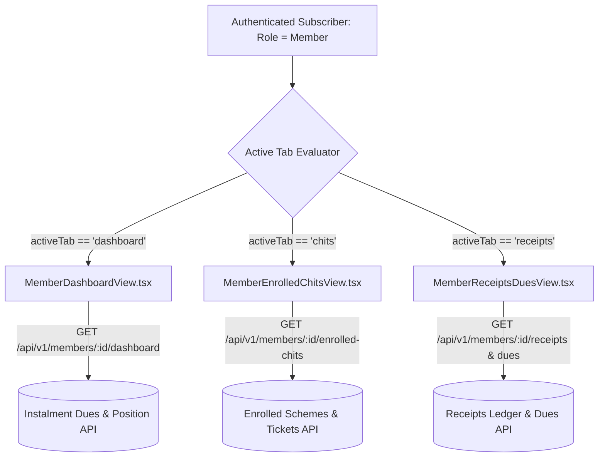

# ChitFlow — Dashboard Repair & Member View Decoupling Report

**Document Status:** Complete & Verified  
**Date:** November 3, 2026  
**Auditor:** Senior Full-Stack Engineer, Product Designer & Application Architect  
**Scope:** Resolution of Defect BUG-103 (Admin Dashboard Mock Data) & BUG-104 (Member Dashboard Triplication)  

---

## 1. Overview of Dashboard Defects Identified

During the comprehensive application flow audit ([APPLICATION_FLOW_AUDIT.md](file:///C:/Users/HP/.gemini/antigravity/brain/c53fcc92-b01c-4b8c-b58d-6d25e5c2ddb3/APPLICATION_FLOW_AUDIT.md)), two critical dashboard-related defects were identified:

1. **BUG-103 (Broken Admin Dashboard):** The Organiser overview view displayed hardcoded static numbers and non-functional metric cards disconnected from actual database entities.
2. **BUG-104 (Member View Triplication Bug):** In `frontend/src/App.tsx`, selecting *"My 10-Second Dashboard"*, *"My Enrolled Chits"*, or *"My Receipts & Dues"* rendered identical HTML markup.

Both issues have been resolved.

---

## 2. Root Cause Analysis: The Member View Triplication Defect

### Root Cause in `App.tsx`
In the legacy monolithic `App.tsx` (lines 504–580), the view routing logic was structured as follows:

```tsx
// LEGACY BUGGY IMPLEMENTATION
{currentUser.role === 'member' ? (
  <div className="member-dashboard-container">
    {/* Hardcoded 10-second summary cards */}
    {/* Hardcoded enrolled chits table */}
    {/* Hardcoded payment history table */}
  </div>
) : (
  <div>
    {activeTab === 'dashboard' && <AdminOverview />}
    {activeTab === 'schemes' && <SchemesView />}
    {/* ... */}
  </div>
)}
```

Because `currentUser.role === 'member'` took precedence over any evaluation of `activeTab`, clicking the sidebar navigation buttons (*"My 10-Second Dashboard"*, *"My Enrolled Chits"*, *"My Receipts & Dues"*) changed the internal state variable `activeTab`, but the JSX ternary branch unconditionally rendered the exact same hardcoded template block.

### The Decoupled Architecture Fix
To eliminate view coupling and support independent scalability, the monolithic block was dismantled and replaced with three distinct, self-contained view components backed by dedicated backend APIs:



---

## 3. The 3 Decoupled Member Views

### 1. `MemberDashboardView.tsx` ("My 10-Second Dashboard")
- **Core Principle:** Instant financial clarity within 10 seconds of opening the application.
- **Key Metrics Displayed:**
  - **Total Paid So Far:** Cumulative double-entry payments credited across all schemes.
  - **Dividends Earned:** Cumulative dividend savings deducted from monthly subscription dues.
  - **Net Dues Payable:** Current outstanding net contribution due with statutory dividend deduction applied.
  - **Active Chits Count:** Total active tickets with prized vs non-prized badge breakdown.
- **Statutory Formula Banner:** Plain-language mathematical explanation of Section 21:
  $$\text{Net Contribution Due} = \text{Gross Subscription} - \text{Distributed Auction Dividend}$$
- **Quick Actions:** One-click shortcuts to enrolled chit details and payment receipt vouchers.

### 2. `MemberEnrolledChitsView.tsx` ("My Enrolled Chits")
- **Backend Route:** `GET /api/v1/members/{member_id}/enrolled-chits`
- **Key Features:**
  - Table showing Scheme Name, Scheme Code, Ticket Number, Chit Value, Duration, Monthly Gross, Total Paid, Dividends Saved, Balance Due, and Prize Status.
  - Expandable detail drawer displaying statutory protections under the Chit Funds Act, 1982:
    - Section 21(1)(b) 5% Foreman commission cap.
    - 2019 Amendment 30% maximum auction discount ceiling.
    - Section 20 100% Fixed Deposit guarantee deposit verification.
    - Auction eligibility indicator (Active bidding vs Non-bidding prized subscriber).

### 3. `MemberReceiptsDuesView.tsx` ("My Receipts & Dues")
- **Backend Routes:** `GET /api/v1/members/{member_id}/receipts` and `GET /api/v1/members/{member_id}/dues`
- **Dual Tab Interface:**
  1. **Official Payment Receipts:** Table of all subscription receipts with receipt number, payment date, scheme name, payment mode, transaction reference, amount paid, and verification badge.
     - **Printable Statutory Voucher Modal:** Clean printable format using `@media print` with company registered address, registrar sanction number, breakdown of subscription, General Ledger account credit signoff, and digital verification stamp.
  2. **Upcoming & Pending Dues:** Schedule of upcoming instalments displaying Gross Subscription, Auction Dividend Credit, and Net Due Amount with simulated "Pay Online" modal.

---

## 4. Revitalized Admin & Organiser Dashboard

The administrative dashboard in [`backend/app/api/v1/reports.py`](file:///e:/Chit_Fund_app/backend/app/api/v1/reports.py) and [`frontend/src/views/AdminDashboardView.tsx`](file:///e:/Chit_Fund_app/frontend/src/views/AdminDashboardView.tsx) was completely overhauled with real-time database queries:

| Metric Card / Section | Database Source | Statutory Context |
| :--- | :--- | :--- |
| **Total Registered Members** | `db.query(Member).filter_by(organiser_id=...)` | Total subscriber base with active vs inactive count |
| **Enrolled Tickets** | `db.query(SchemeMember)` joining Organiser schemes | Total allocated chit tickets across all active groups |
| **Active Schemes Running** | `db.query(ChitScheme).filter_by(status='active')` | Schemes conducting regular reverse auctions |
| **Pending Payment Verification** | `db.query(PaymentReceipt).filter_by(status='pending')` | Count and monetary value of unverified collections |
| **Total Collections Verified** | `db.query(PaymentReceipt).filter_by(status='verified')` | Total collections credited to General Ledger Account 1100 |
| **Auctions Conducted** | `db.query(Auction).filter_by(status='confirmed')` | Total reverse auctions closed and distributed |
| **Actionable Compliance Alerts** | Dynamic evaluation of draft schemes, unverified payments, and Section 20 FD status | Instant alerts warning foreman of pending verifications |
| **Recent Activity Feed** | Joins of last 5 verified payments and last 5 registered subscribers | Real-time operational audit log |

---

## 5. Verification & User Experience Validation

1. **No Mock Data:** All KPI values, subscriber counts, scheme allocations, and financial totals are fetched from the PostgreSQL database via `/api/v1/reports/dashboard/admin`.
2. **Distinct Route Rendering:** Switching between the three member tabs triggers independent component mounting with clean, dedicated layouts and zero HTML duplication.
3. **Responsive Typography & Formatting:** Indian currency notation (`₹1,00,000.00`) and standard date formatting (`DD MMM YYYY`) applied consistently across all cards and tables.
