# ChitFlow — JWT Security & Secret Management Report

**Document**: Deliverable 3 (`JWT_SECURITY_REPORT.md`)  
**Scope**: In-depth Cryptographic Audit of Token Architecture, Signing, Verification, and Revocation  
**Date**: November 3, 2026  
**Auditor**: Senior QA Engineer, Security Tester & Financial Systems Auditor  

---

## 1. Cryptographic Configuration & Secret Management

### 1.1 Secret Key Entropy & Production Fail-Secure Guard
* **Vulnerability Identified (SEC-002)**: In the initial implementation, `SECRET_KEY` was configured with `os.getenv("SECRET_KEY", "chitflow-super-secret-production-signing-key-2026-secure")`. In production, this fallback would permit deployment with a publicly accessible signing key.
* **Remediation Implemented**:
  [`backend/app/core/security.py`](file:///e:/Chit_Fund_app/backend/app/core/security.py#L17-L30) introduces an explicit fail-secure environment check:
  ```python
  INSECURE_DEV_SECRET = "chitflow-super-secret-production-signing-key-2026-secure"
  ENVIRONMENT = os.getenv("ENVIRONMENT", "development").lower()
  _raw_secret = os.getenv("SECRET_KEY")

  if ENVIRONMENT in ("production", "prod"):
      if not _raw_secret:
          raise RuntimeError(
              "CRITICAL SECURITY ERROR: SECRET_KEY environment variable is mandatory in production."
          )
      if _raw_secret == INSECURE_DEV_SECRET or len(_raw_secret) < 32:
          raise RuntimeError(
              "CRITICAL SECURITY ERROR: SECRET_KEY in production must be a high-entropy secret of at least 32 characters and cannot match the development placeholder."
          )
      SECRET_KEY = _raw_secret
  else:
      SECRET_KEY = _raw_secret if _raw_secret else INSECURE_DEV_SECRET
  ```
* **Verification**: Verified via `test_security_verification.py::test_02_production_secret_key_fails_securely_if_missing_or_default`. If `ENVIRONMENT=production` and `SECRET_KEY` is absent or uses the placeholder, `importlib.reload(security)` immediately crashes the boot process with `RuntimeError`.

---

## 2. Token Lifecycle & Claim Specifications

```mermaid
sequenceDiagram
    autonumber
    actor Client as User / Frontend (sessionStorage)
    participant Auth as /api/v1/auth/login
    participant Core as core/security.py
    participant DB as Database (revoked_tokens)
    participant Protected as Protected Endpoint

    Client->>Auth: POST credentials (mobile, pwd)
    Auth->>Core: verify_password() & create_access_token()
    Core-->>Auth: JWT (claims: sub, role, org, mem, jti, exp, iat)
    Auth-->>Client: HTTP 200 { access_token, expires_in: 86400 }

    Note over Client,Protected: Authorized Request Flow
    Client->>Protected: GET /api/v1/schemes (Bearer JWT)
    Protected->>Core: decode_access_token(algorithms=['HS256'])
    Protected->>DB: Check if jti in revoked_tokens table
    DB-->>Protected: Not Revoked
    Protected-->>Client: HTTP 200 OK (Data Scoped to Tenant)

    Note over Client,Protected: Logout / Session Invalidation Flow
    Client->>Auth: POST /api/v1/auth/logout (Bearer JWT)
    Auth->>DB: INSERT into revoked_tokens (jti, user_id, expires_at)
    Auth-->>Client: HTTP 200 Session Invalidated

    Note over Client,Protected: Token Re-use Attempt (Post-Logout)
    Client->>Protected: GET /api/v1/schemes (Reused Bearer JWT)
    Protected->>DB: Check if jti in revoked_tokens table
    DB-->>Protected: Found in Revocation Blacklist!
    Protected-->>Client: HTTP 401 Session has been invalidated
```



### 2.1 Standardized Token Claims

Every issued token contains 7 standard claims:
1. `sub`: User ID (UUID string).
2. `role`: Access role (`super_admin`, `organiser`, `accountant`, `member`).
3. `org`: Organiser tenant ID (UUID string or `null` for unattached admins).
4. `mem`: Member profile ID (UUID string if `role == "member"`).
5. `jti`: Unique Token Identifier (UUIDv4) generated per login instance.
6. `iat`: Unix timestamp of token creation.
7. `exp`: Unix timestamp of token expiration (default 1,440 minutes / 24 hours).

### 2.2 Algorithm Restriction & Signature Verification
* **Algorithm Pinning**: The token decoder explicitly specifies `algorithms=[ALGORITHM]` (`HS256`).
* **Algorithm Confusion & "none" Attack Defense**: `jose.jwt.decode` rejects any incoming token bearing `alg: "none"` or mismatched symmetric/asymmetric algorithms, preventing algorithmic downgrade vulnerabilities.

---

## 3. Server-Side Token Revocation & Invalidation

### 3.1 The `RevokedToken` Storage Model
To solve the standard stateless JWT vulnerability (inability to invalidate tokens before natural expiration), ChitFlow maintains an indexed database blacklist in [`backend/app/models/entities.py`](file:///e:/Chit_Fund_app/backend/app/models/entities.py#L248-L257):

```python
class RevokedToken(Base):
    __tablename__ = "revoked_tokens"

    id = Column(String(36), primary_key=True, default=lambda: str(uuid.uuid4()))
    jti = Column(String(64), unique=True, nullable=False, index=True)
    user_id = Column(String(36), ForeignKey("users.id", ondelete="CASCADE"), nullable=True)
    revoked_at = Column(DateTime, default=datetime.utcnow, nullable=False)
    expires_at = Column(DateTime, nullable=False, index=True)
```

### 3.2 Revocation Verification in `get_current_user`
On every authenticated request, [`deps.py`](file:///e:/Chit_Fund_app/backend/app/api/deps.py#L38-L45) performs an `O(1)` indexed query:
```python
revoked = db.query(RevokedToken).filter(RevokedToken.jti == jti).first()
if revoked:
    raise HTTPException(
        status_code=status.HTTP_401_UNAUTHORIZED,
        detail="Session has been invalidated. Please log in again.",
        headers={"WWW-Authenticate": "Bearer"},
    )
```

### 3.3 Application Restart Behavior
Because blacklisted tokens are persisted in the SQL database (`revoked_tokens` table) rather than in-memory volatile cache, **token revocation persists across server reboots, worker restarts, and container redeployments**.

### 3.4 Re-use Prevention Test Evidence
Tested and verified in:
- `test_auth_rbac.py::test_08_access_after_logout_rejected`
- `test_security_verification.py::test_06_revoked_token_cannot_be_reused`
In both tests, any call to `/api/v1/auth/me` or `/api/v1/schemes` after `/logout` returns `401 Unauthorized` with `"Session has been invalidated"`.

---

## 4. Frontend Token Management & Migration Recommendation

### 4.1 Current Assessment (`sessionStorage`)
* **Storage Location**: Web browser `window.sessionStorage`.
* **Behavior**:
  - Automatically deleted when the subscriber or operator closes the browser tab.
  - Not shared across tabs or windows, limiting cross-tab credential leaks.
* **Residual Risk**: Any successful Cross-Site Scripting (XSS) exploit can read `sessionStorage.getItem('chitflow_token')`.

### 4.2 Recommended Production Upgrade: HttpOnly Cookies
For production compliance with financial data guidelines, the following architectural migration is recommended:
1. **Set-Cookie Header**: On `/auth/login`, transmit the JWT inside a `Set-Cookie` header:
   ```http
   Set-Cookie: access_token=eyJhbGci...; Path=/api; HttpOnly; Secure; SameSite=Strict; Max-Age=86400
   ```
2. **Double-Submit Anti-CSRF Token**:
   - Issue a cryptographically random CSRF token in a non-HttpOnly cookie (`XSRF-TOKEN`).
   - Require frontend clients to echo this token in an `X-XSRF-TOKEN` HTTP header on state-changing requests (`POST`, `PUT`, `DELETE`).
   - Backend verifies header matches cookie before executing financial operations.
