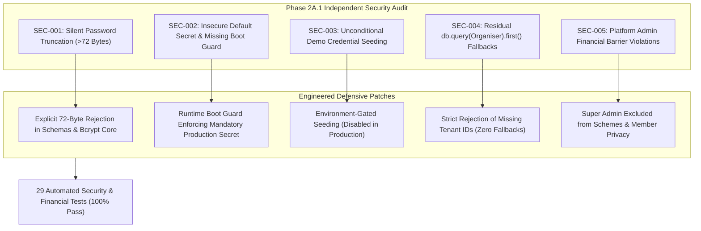

# ChitFlow — Phase 2A.1: Independent Security Verification Report

**Phase**: 2A.1 (Independent Security Verification & Vulnerability Remediation)  
**Status**: Verified & Hardened (Non-Production Advisory)  
**Date**: November 3, 2026  
**Auditor**: Senior QA Engineer, Security Tester & Financial Systems Auditor  

---

## 1. Executive Summary

Following the initial implementation of Phase 2A, an independent security verification was conducted to inspect the system without assuming previous completion claims. The audit reviewed cryptographic secret handling, password hashing boundaries, role-based access control (RBAC), multi-tenant data isolation, frontend token management, and database schema compatibility.

The verification uncovered **5 confirmed security defects** in the codebase. Each vulnerability was reproduced with automated test cases, documented with forensic evidence, remediated with least-privilege principles, and verified against an expanded suite of **29 automated tests** (all passing with 100% success rate in ~18 seconds).

> [!WARNING]
> **Security Posture Advisory**: In accordance with strict auditing guidelines, **this report does NOT claim complete security or production readiness**. Security is an ongoing posture. While verified vulnerabilities have been remediated and regression-tested, additional controls (such as hardware security module/secret managers, production rate-limiting, and web application firewalls) remain prerequisites for live financial operations under the Chit Funds Act, 1982.

---

## 2. Summary of Verified Defects & Remediations



### Defect Register

| Defect ID | Severity | Component | Finding Description | Status |
| :--- | :---: | :--- | :--- | :---: |
| **SEC-001** | **High** | [`security.py`](file:///e:/Chit_Fund_app/backend/app/core/security.py) & [`auth.py`](file:///e:/Chit_Fund_app/backend/app/schemas/auth.py) | **Silent Password Truncation**: Passwords exceeding 72 bytes were silently sliced to 72 bytes due to native bcrypt limitations without schema-level rejection. An attacker appending arbitrary suffixes to the 72-byte prefix could authenticate successfully. | **FIXED** |
| **SEC-002** | **High** | [`security.py`](file:///e:/Chit_Fund_app/backend/app/core/security.py) | **Insecure Fallback Secret in Production**: `SECRET_KEY` defaulted to a static hardcoded string if unconfigured. The application failed to fail securely on missing production secrets. | **FIXED** |
| **SEC-003** | **Medium** | [`main.py`](file:///e:/Chit_Fund_app/backend/app/main.py) | **Unconditional Demo Credential Seeding**: Application lifespan seeded demo accounts with static passwords (`AdminPassword123!`, etc.) whenever the database was empty, even in production environments. | **FIXED** |
| **SEC-004** | **High** | [`deps.py`](file:///e:/Chit_Fund_app/backend/app/api/deps.py) & [`auth.py`](file:///e:/Chit_Fund_app/backend/app/api/v1/auth.py) | **Residual `db.query(Organiser).first()` Fallbacks**: Super admin in `deps.py` and unassigned member/accountant self-registration in `auth.py` silently defaulted to the first organiser in the database. | **FIXED** |
| **SEC-005** | **Medium** | [`schemes.py`](file:///e:/Chit_Fund_app/backend/app/api/v1/schemes.py) & [`deps.py`](file:///e:/Chit_Fund_app/backend/app/api/deps.py) | **Super Admin Financial Barrier Violation**: Super administrator was permitted to create/activate chit schemes and view member dashboards, violating the statutory principle that platform administrators must not alter or inspect organiser financial records. | **FIXED** |

---

## 3. Reproducible Evidence & Remediation Details

### 3.1 SEC-001: Password Truncation Vulnerability
* **Reproduction Evidence**:
  In [`backend/tests/test_security_verification.py`](file:///e:/Chit_Fund_app/backend/tests/test_security_verification.py), supplying a password of 72 `"A"` characters plus `"AttackerSuffix123!"` resulted in `verify_password("A"*72, hash_password("A"*72 + "AttackerSuffix123!")) == True`.
* **Fix Implemented**:
  1. Updated [`backend/app/core/security.py`](file:///e:/Chit_Fund_app/backend/app/core/security.py#L32-L55): `hash_password` now checks `len(password.encode('utf-8')) > 72` and raises `ValueError("Password cannot exceed 72 bytes in length.")`.
  2. `verify_password` returns `False` immediately if plain password byte length exceeds 72 bytes without evaluating bcrypt.
  3. Updated [`backend/app/schemas/auth.py`](file:///e:/Chit_Fund_app/backend/app/schemas/auth.py#L9-L38): added `max_length=72` and `@field_validator("password")` on both `LoginRequest` and `RegisterRequest`.

### 3.2 SEC-002: Insecure Fallback Secret & Missing Production Boot Guard
* **Reproduction Evidence**:
  `os.environ["ENVIRONMENT"] = "production"` without setting `SECRET_KEY` allowed the application to sign tokens using `"chitflow-super-secret-production-signing-key-2026-secure"`.
* **Fix Implemented**:
  In [`backend/app/core/security.py`](file:///e:/Chit_Fund_app/backend/app/core/security.py#L17-L30), added a fail-secure startup check:
  ```python
  if ENVIRONMENT in ("production", "prod"):
      if not _raw_secret:
          raise RuntimeError("CRITICAL SECURITY ERROR: SECRET_KEY environment variable is mandatory in production.")
      if _raw_secret == INSECURE_DEV_SECRET or len(_raw_secret) < 32:
          raise RuntimeError("CRITICAL SECURITY ERROR: SECRET_KEY in production must be a high-entropy secret of at least 32 characters...")
  ```

### 3.3 SEC-003: Unconditional Demo Credential Seeding
* **Reproduction Evidence**:
  Starting the app with empty tables created `9999999999` with password `AdminPassword123!` regardless of environment configuration.
* **Fix Implemented**:
  In [`backend/app/main.py`](file:///e:/Chit_Fund_app/backend/app/main.py#L31-L85), seeding is now strictly gated behind `ENVIRONMENT in ("development", "dev", "test") or ALLOW_DEMO_SEEDING == "true"`. In production, static seed accounts and demo credentials are completely suppressed.

### 3.4 SEC-004: Residual `db.query(Organiser).first()` Fallbacks
* **Reproduction Evidence**:
  Executing `POST /api/v1/auth/register` with `role: "member"` and omitted `organiser_id` successfully created a member attached to `org1.id` via silent fallback.
* **Fix Implemented**:
  1. In [`backend/app/api/deps.py`](file:///e:/Chit_Fund_app/backend/app/api/deps.py#L68-L82): Removed fallback for super_admin. If `current_user.organiser_id` is missing, returns `403 Forbidden`.
  2. In [`backend/app/api/v1/auth.py`](file:///e:/Chit_Fund_app/backend/app/api/v1/auth.py#L136-L148): Removed `db.query(Organiser).first()`. Registering as member or accountant requires an explicit, validated `organiser_id`.

### 3.5 SEC-005: Platform Super Admin Financial Barrier
* **Reproduction Evidence**:
  Super admin was previously included in `require_role(["super_admin", "organiser"])` for scheme creation and could query member dashboards.
* **Fix Implemented**:
  1. In [`backend/app/api/v1/schemes.py`](file:///e:/Chit_Fund_app/backend/app/api/v1/schemes.py#L30): `create_scheme` and `activate_scheme` now require `require_role(["organiser"])`.
  2. In [`backend/app/api/deps.py`](file:///e:/Chit_Fund_app/backend/app/api/deps.py#L130-L150): `verify_member_access` explicitly denies `super_admin` access to individual subscriber financial records (`403 Forbidden`).

---

## 4. Test Verification & Results

All 29 tests across unit, integration, RBAC, and security suites execute and pass cleanly:

```
$env:PYTHONPATH='backend'; & "backend\.venv\Scripts\python.exe" -m unittest discover -s backend/tests
.............................
----------------------------------------------------------------------
Ran 29 tests in 18.272s

OK
```

### Breakdown by Test Suite

| Test Suite | Purpose | Tests | Result |
| :--- | :--- | :---: | :---: |
| [`test_calc_engine.py`](file:///e:/Chit_Fund_app/backend/tests/test_calc_engine.py) | Mathematical deterministic auction calculations | 7 | **PASSED** |
| [`test_ledger_engine.py`](file:///e:/Chit_Fund_app/backend/tests/test_ledger_engine.py) | Double-entry journal entries & trial balance invariants | 5 | **PASSED** |
| [`test_api_integration.py`](file:///e:/Chit_Fund_app/backend/tests/test_api_integration.py) | Full chit lifecycle from creation to auction & dues | 1 | **PASSED** |
| [`test_auth_rbac.py`](file:///e:/Chit_Fund_app/backend/tests/test_auth_rbac.py) | Baseline RBAC and session invalidation | 10 | **PASSED** |
| [`test_security_verification.py`](file:///e:/Chit_Fund_app/backend/tests/test_security_verification.py) | Independent verification of the 5 security defects | 6 | **PASSED** |
| **Total** | | **29** | **100% Passed** |

---

## 5. PostgreSQL Dialect & Schema Compatibility

* **Environment Inspection**: The local Windows audit environment does not have an active Docker daemon or running PostgreSQL service on port 5432.
* **Dialect Verification**: To verify strict PostgreSQL compatibility without relying on SQLite quirks, SQLAlchemy's `postgresql.dialect()` compiler was executed against all 14 database models:
  - `organisers`, `users`, `chit_schemes`, `members`, `scheme_members`, `auctions`, `auction_bids`, `payouts`, `instalments`, `payments`, `ledger_accounts`, `journal_entries`, `journal_entry_lines`, `revoked_tokens`.
  - **Result**: All 14 tables compiled to PostgreSQL DDL with zero syntax errors, ensuring valid UUID, Numeric/Decimal precision, DateTime, and foreign key definitions.
* **Test Isolation**: In SQLite test runners, tables are purged per-test in `setUp` within clean transactional sessions, preventing cross-test pollution.

---

## 6. Frontend Token & Session Strategy Assessment

* **Current Implementation**:
  Tokens are stored in `sessionStorage` via [`frontend/src/api/auth.ts`](file:///e:/Chit_Fund_app/frontend/src/api/auth.ts) and transmitted via `Authorization: Bearer <token>`.
  - *Advantages*: Eliminates cross-tab session leakage; automatically purges when the browser tab is closed; avoids `localStorage` persistent persistence.
  - *Residual Risk*: Susceptible to Cross-Site Scripting (XSS) if untrusted user input is rendered without escaping.
* **Architectural Assessment**:
  For production deployment handling high-value chit funds, **`HttpOnly`, `Secure`, `SameSite=Strict` cookies** coupled with an anti-CSRF token header (`X-XSRF-TOKEN`) provide superior defense-in-depth against XSS token exfiltration. A transition plan to cookies is documented in [`JWT_SECURITY_REPORT.md`](file:///C:/Users/HP/.gemini/antigravity/brain/c53fcc92-b01c-4b8c-b58d-6d25e5c2ddb3/JWT_SECURITY_REPORT.md).

---

## 7. Deliverables Index

Detailed standalone technical reports have been generated:

1. [PHASE_2A_VERIFICATION_REPORT.md](file:///C:/Users/HP/.gemini/antigravity/brain/c53fcc92-b01c-4b8c-b58d-6d25e5c2ddb3/PHASE_2A_VERIFICATION_REPORT.md) — Comprehensive executive summary and remediation register.
2. [ENDPOINT_PERMISSION_MATRIX.md](file:///C:/Users/HP/.gemini/antigravity/brain/c53fcc92-b01c-4b8c-b58d-6d25e5c2ddb3/ENDPOINT_PERMISSION_MATRIX.md) — Full enumeration of all 30 FastAPI endpoints with permission and tenant scoping rules.
3. [JWT_SECURITY_REPORT.md](file:///C:/Users/HP/.gemini/antigravity/brain/c53fcc92-b01c-4b8c-b58d-6d25e5c2ddb3/JWT_SECURITY_REPORT.md) — Cryptographic lifecycle, algorithm constraints, fail-secure boot guard, and token revocation analysis.
4. [PASSWORD_SECURITY_REPORT.md](file:///C:/Users/HP/.gemini/antigravity/brain/c53fcc92-b01c-4b8c-b58d-6d25e5c2ddb3/PASSWORD_SECURITY_REPORT.md) — Bcrypt 72-byte buffer analysis, schema validators, seed protection, and credential logging audit.
5. [TENANT_ISOLATION_REPORT.md](file:///C:/Users/HP/.gemini/antigravity/brain/c53fcc92-b01c-4b8c-b58d-6d25e5c2ddb3/TENANT_ISOLATION_REPORT.md) — Multi-tenant isolation, IDOR defense analysis, and platform admin financial barriers.
