# ChitFlow — GitHub Pre-Push Security Audit Report

**Audit Objective**: Prepare ChitFlow codebase for private GitHub repository upload  
**Date**: November 3, 2026  
**Auditor**: Senior QA Engineer, Security Tester & Full-Stack Systems Auditor  
**Final Verdict**: **SAFE TO PUSH** (to Private GitHub Repository)  

---

## 1. Executive Summary

A comprehensive pre-push security audit was conducted on the ChitFlow project (`e:\Chit_Fund_app`). The repository was inspected across 10 critical security vectors: environment variables, hardcoded credentials, JWT secret handling, API keys, database connection strings, demo seeding logic, local databases and dumps, financial records, KYC data, and compiler/runtime artifacts.

All sensitive local files (including `chitflow.db`, local environment files, virtual environments, build artifacts, and bytecode caches) are strictly excluded via an updated, hardened `.gitignore`. A safe, documented `.env.example` has been established at both repository root and backend root. Git commit history (`c96707e`) was audited and verified to contain zero live secrets, cloud API keys, or real personal financial data.

---

## 2. 10-Point Security Inspection Matrix

```mermaid
flowchart LR
    subgraph RepoInspection["Pre-Push Security Inspection"]
        direction TB
        I1["1. Environment Files (.env)"] --> R1["Excluded by .gitignore; .env.example created"]
        I2["2. Hardcoded Passwords"] --> R2["No live secrets; demo passwords isolated to dev/test"]
        I3["3. JWT Secret Config"] --> R3["Enforces high-entropy secret; fails securely in prod"]
        I4["4. API Keys & Cloud Tokens"] --> R4["Zero live AWS, GCP, GitHub, or OpenAI keys"]
        I5["5. DB Connection Strings"] --> R5["Uses environment var; defaults to local sqlite"]
        I6["6. Demo Seeding"] --> R6["Strictly gated behind ENVIRONMENT != 'production'"]
        I7["7. Local Databases (.db)"] --> R7["chitflow.db excluded by .gitignore; not tracked"]
        I8["8. Financial Documents"] --> R8["No real receipts or ledgers; uploads/ excluded"]
        I9["9. KYC & Member PII"] --> R9["Zero real PII; all seed profiles are synthetic"]
        I10["10. Generated Files"] --> R10[".venv, node_modules, dist, __pycache__ excluded"]
    end
```



| # | Inspection Vector | Current Repository State | Risk Level | Status |
| :-: | :--- | :--- | :---: | :---: |
| **1** | **Environment Files** | No active `.env` file exists on disk. `.env.example` established. All `.env*` excluded by `.gitignore`. | **Low** | **PASSED** |
| **2** | **Hardcoded Passwords** | No production passwords in source. Demo credentials (`AdminPassword123!`) are strictly gated to non-production environments. | **Low** | **PASSED** |
| **3** | **JWT Secret Configuration** | In production, `security.py` strictly mandates high-entropy `SECRET_KEY` ($\ge 32$ chars) and refuses to boot with defaults. | **Low** | **PASSED** |
| **4** | **API Keys & Cloud Tokens** | Automated regex scan for AWS (`AKIA`), OpenAI (`sk-`), GitHub (`ghp_`), Google Cloud (`AIza`), and private keys yielded **0 findings**. | **None** | **PASSED** |
| **5** | **DB Connection Strings** | `session.py` references `os.getenv("DATABASE_URL")` with fallback to local `sqlite:///./chitflow.db`. No production database URIs or credentials. | **None** | **PASSED** |
| **6** | **Demo Account Seeding** | Gated in `main.py` by `ENVIRONMENT in ("development", "dev", "test")`. Completely disabled in production. | **Low** | **PASSED** |
| **7** | **Local Databases & Dumps** | Local development database `chitflow.db` (196 KB) is **untracked** and strictly ignored by `.gitignore` (`*.db`). | **Low** | **PASSED** |
| **8** | **Uploaded Financial Documents** | No uploads or receipts exist on disk. `uploads/`, `receipts/`, and `storage/` are explicitly added to `.gitignore`. | **None** | **PASSED** |
| **9** | **KYC & Member PII** | No real member documents, Aadhaar cards, PAN cards, or phone numbers exist. All names and numbers (`9849012345`, etc.) are synthetic test mocks. | **None** | **PASSED** |
| **10** | **Generated Files & Binaries** | `.venv/`, `node_modules/`, `dist/`, `__pycache__/`, `.pytest_cache/` are verified untracked and excluded by `.gitignore`. | **None** | **PASSED** |

---

## 3. Git History & Staged Files Inspection

### 3.1 Existing Commit History Audit
* **History Depth**: 1 existing commit (`c96707e`).
* **Commit Subject**: `feat(chitflow): initial implementation of core calculation engine, double-entry ledger, FastAPI backend, and React frontend`.
* **Findings**:
  - 51 files committed (7,541 insertions).
  - Contains architecture documentation, core calculation math, models, schemas, and React components.
  - **No private keys, cloud tokens, database dumps, or real credentials were found in the commit diff.**
  - No Git history rewrite (`git filter-branch` / BFG) is required.

### 3.2 Current Working Tree & Staged Status
* **Staged Files**: `0` files currently staged.
* **Modified Tracked Files**: Application improvements, RBAC guards, and bug fixes across 31 files.
* **Untracked Security Additions**:
  - `.env.example` & `backend/.env.example`
  - `backend/app/api/v1/auth.py`
  - `backend/app/core/security.py`
  - `backend/app/schemas/auth.py`
  - `backend/tests/test_auth_rbac.py`
  - `backend/tests/test_security_verification.py`
  - `frontend/src/api/auth.ts`

---

## 4. Repository Classification: Files Safe vs Excluded

### 4.1 Files Safe to Commit
1. **Application Source Code**:
   - Backend APIs: [`backend/app/api/`](file:///e:/Chit_Fund_app/backend/app/api/) (including `auth.py`, `schemes.py`, `auctions.py`, `payments.py`, `payouts.py`, `members.py`, `reports.py`).
   - Core Engines: [`backend/app/core/`](file:///e:/Chit_Fund_app/backend/app/core/) (`calc_engine.py`, `ledger_engine.py`, `security.py`).
   - Database Models & Schemas: [`backend/app/models/`](file:///e:/Chit_Fund_app/backend/app/models/) and [`backend/app/schemas/`](file:///e:/Chit_Fund_app/backend/app/schemas/).
   - Application Lifecycle & DB Setup: [`backend/app/main.py`](file:///e:/Chit_Fund_app/backend/app/main.py), [`backend/app/db/session.py`](file:///e:/Chit_Fund_app/backend/app/db/session.py).
   - Test Suites: All 5 test files in [`backend/tests/`](file:///e:/Chit_Fund_app/backend/tests/) (all 29 tests passing).
   - Frontend Code: [`frontend/src/`](file:///e:/Chit_Fund_app/frontend/src/), `index.html`, `vite.config.ts`, `package.json`, `package-lock.json`.
2. **Configuration & Documentation**:
   - `.gitignore` (Root and Frontend).
   - `.env.example` & `backend/.env.example`.
   - `Chitflow Technical Architecture Document.md`.
   - `requirements.txt`.

### 4.2 Files Excluded via `.gitignore`
* `chitflow.db` & `backend/chitflow.db` (Local SQLite databases).
* `.env` & `.env.*` (Deployment and local secrets).
* `backend/.venv/` & `.venv/` (Python virtual environment).
* `frontend/node_modules/` (Node package dependencies).
* `frontend/dist/` (Production build artifacts).
* `__pycache__/` & `*.pyc` (Python bytecode).
* `.pytest_cache/` & `.coverage` (Test caches and coverage reports).
* `uploads/`, `receipts/`, `kyc/`, `storage/` (User uploads and documents).
* `*.log` (Runtime and debug logs).

---

## 5. Secrets Requiring Rotation

> [!NOTE]
> **No live production secrets require immediate rotation** because no external production credentials (AWS keys, payment gateway API secrets, cloud database passwords, SMS gateway keys) were ever introduced or committed to this repository.

### Developer & Staging Advisories:
1. **Mock Passwords**:
   The static strings `AdminPassword123!`, `OrganiserPassword123!`, and `AccountantPassword123!` used in test fixtures are strictly mock credentials. If any developer has used these passwords in any external staging or testing system, they should be changed immediately.
2. **Production `SECRET_KEY` Generation**:
   When deploying the production backend, an administrator must generate a new 256-bit cryptographic secret using:
   ```bash
   openssl rand -hex 32
   ```
   Do not use any placeholder string from documentation.

---

## 6. Remaining Risks & Best Practices

1. **Private vs Public Repository**:
   - This audit approves upload to a **Private GitHub repository**.
   - If the repository is ever made public in the future, documentation referencing mock phone numbers (`9849012345`) or mock company names should be replaced with `example.com` and standard RFC 5737 dummy values.
2. **Secret Scanning in GitHub**:
   - Enable GitHub Secret Scanning and Push Protection on the repository settings page upon creation.
3. **Pre-Commit Hooks**:
   - Recommended: Configure `pre-commit` with `detect-secrets` or `gitleaks` to prevent accidental credential commits during future development phases.

---

## 7. Final Recommendation

```
================================================================================
                    FINAL AUDIT VERDICT: SAFE TO PUSH
================================================================================
  - All local databases, virtual environments, and caches are ignored.
  - Git history is clean with zero exposed secrets.
  - Safe .env.example files are in place.
  - Production secrets are strictly enforced via environment variables.
  - All 29 automated tests pass with 100% success rate.
================================================================================
```

**Next Action**: Ready to stage and commit the verified security additions and push to the user's private GitHub repository upon explicit approval.
