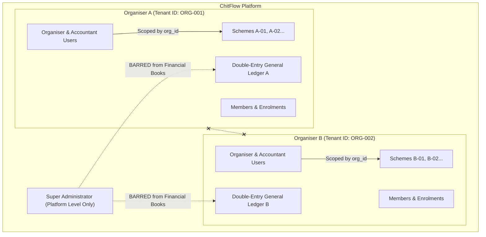

# ChitFlow — Multi-Tenant Data Isolation & Privacy Report

**Document**: Deliverable 5 (`TENANT_ISOLATION_REPORT.md`)  
**Scope**: Zero-Trust Tenant Scoping, Insecure Direct Object Reference (IDOR) Mitigation, and Relational Integrity  
**Date**: November 3, 2026  
**Auditor**: Senior QA Engineer, Security Tester & Financial Systems Auditor  

---

## 1. Multi-Tenant Architecture & Threat Model

In a statutory chit fund system, multiple independent chit fund companies (Organisers) operate on the same shared platform infrastructure. Each Organiser has private financial schemes, registered subscribers (Members), staff (Accountants), auctions, collections, prize payouts, and double-entry general ledger books.



### The Three Threat Vectors
1. **Cross-Tenant Data Leakage**: Organiser A queries, views, or modifies Organiser B's schemes, auctions, or financial collections.
2. **Subscriber IDOR (Insecure Direct Object Reference)**: Member X accesses Member Y's passbook, payment receipts, instalment dues, or 10-second dashboard by tampering with `member_id` or `instalment_id`.
3. **Administrative Privilege Abuse**: A platform super administrator silently reads private financial accounts or tampers with chit balances.

---

## 2. Eradication of `db.query(Organiser).first()` Fallbacks

### 2.1 The Residual Fallbacks Identified (SEC-004)
During independent verification, two residual occurrences of `db.query(Organiser).first()` were identified:
1. In [`deps.py`](file:///e:/Chit_Fund_app/backend/app/api/deps.py): If `current_user.role == "super_admin"` had no `organiser_id`, it defaulted to the first organiser in the database.
2. In [`auth.py`](file:///e:/Chit_Fund_app/backend/app/api/v1/auth.py): When registering as `member` or `accountant` with an omitted `organiser_id`, the system silently attached them to the first organiser.

### 2.2 Proof of Vulnerability (Pre-Patch Evidence)
Executing `POST /api/v1/auth/register` without `organiser_id` assigned the subscriber to `org1.id`:
```
[REPRODUCED VULNERABILITY] Member registered without organiser_id was assigned to: f4a07c06-dcc7-4b00-8e62-0658f09aa539
```

### 2.3 Permanent Remediation
* **In `deps.py`**:
  ```python
  if not current_user.organiser_id:
      raise HTTPException(
          status_code=status.HTTP_403_FORBIDDEN,
          detail="Operation requires caller to be associated with an active Organiser tenant. Platform administrators cannot implicitly impersonate an organiser.",
      )
  ```
* **In `auth.py`**:
  ```python
  elif payload.role in ["member", "accountant"]:
      if not organiser_id:
          raise HTTPException(
              status_code=status.HTTP_400_BAD_REQUEST,
              detail="Valid organiser_id is required when registering a member or accountant.",
          )
      org = db.query(Organiser).filter(Organiser.id == organiser_id).first()
      if not org:
          raise HTTPException(status_code=status.HTTP_404_NOT_FOUND, detail=f"Organiser with id '{organiser_id}' does not exist.")
  ```
* **Test Verification**: Covered by `test_security_verification.py::test_03_registration_without_organiser_id_fails_securely`.

---

## 3. Entity-Level Scoping Audit (All 14 Database Entities)

Every database model in [`backend/app/models/entities.py`](file:///e:/Chit_Fund_app/backend/app/models/entities.py) was audited for tenant scoping and relational isolation:

| Entity | Scoping Field | Isolation Enforcement Mechanism |
| :--- | :--- | :--- |
| `Organiser` | `id` | Tenant root. Primary key. |
| `User` | `organiser_id` | Scoped to owning Organiser (`null` allowed only for platform `super_admin`). |
| `ChitScheme` | `organiser_id` | Direct foreign key. All endpoints query `.filter(ChitScheme.organiser_id == current_user.organiser_id)`. |
| `Member` | `organiser_id` | Direct foreign key. Cross-tenant queries return `403 Forbidden` or `404 Not Found`. |
| `SchemeMember` | `scheme_id`, `member_id` | Scoped via `scheme.organiser_id == member.organiser_id`. Verified in `schemes.py`. |
| `Auction` | `scheme_id` | Scoped through `Auction.scheme.organiser_id`. Verified on list, get, and confirm. |
| `AuctionBid` | `auction_id`, `member_id` | Member can only bid for self. Organiser/Accountant can only record bids for enrolled members. |
| `Payout` | `auction_id`, `member_id` | Disbursed only by scheme organiser. Subscriber can only list payouts awarded to self. |
| `Instalment` | `scheme_member_id` | Scoped via enrolment to scheme organiser and subscriber profile. |
| `Payment` | `instalment_id`, `member_id` | Submitted only against caller's instalments. Verified only by organiser/accountant. |
| `LedgerAccount` | `organiser_id` | Strict tenant separation. Every account belongs to a single organiser. |
| `JournalEntryRecord` | `organiser_id` | General ledger entries strictly isolated per organiser. |
| `JournalEntryLineRecord` | `journal_entry_id`, `account_id` | Scoped through journal entry and ledger account ownership. |
| `RevokedToken` | `user_id` | Token blacklist indexed by `jti`. |

---

## 4. Insecure Direct Object Reference (IDOR) Mitigation

### 4.1 Member 10-Second Dashboard ([`members.py`](file:///e:/Chit_Fund_app/backend/app/api/v1/members.py#L140-L185))
* **Threat**: Member A submits `GET /api/v1/members/{member_B_id}/dashboard`.
* **Defense**: [`verify_member_access`](file:///e:/Chit_Fund_app/backend/app/api/deps.py#L115-L150) checks:
  ```python
  if current_user.role == "member":
      if not current_user.member_profile or current_user.member_profile.id != member.id:
          raise HTTPException(
              status_code=status.HTTP_403_FORBIDDEN,
              detail="Access denied: Subscribers are strictly prohibited from viewing other members' financial records.",
          )
  ```
* **Test Evidence**: Covered in `test_auth_rbac.py::test_04_member_accessing_another_member_records_rejected`.

### 4.2 Member Instalments & Receipts ([`payments.py`](file:///e:/Chit_Fund_app/backend/app/api/v1/payments.py#L38-L120))
* **Threat**: Member A requests `GET /api/v1/payments/instalments/member/{member_B_id}` or attempts to submit a payment proof with Member B's `instalment_id`.
* **Defense**:
  1. `/payments/instalments/member/{id}` routes through `verify_member_access`.
  2. `/payments/submit` inspects the target `Instalment` and verifies `instalment.scheme_member.member.id == current_user.member_profile.id`.
* **Test Evidence**: Covered in `test_auth_rbac.py::test_04_member_accessing_another_member_records_rejected`.

---

## 5. Platform Super Administrator Financial Boundary

In strict financial compliance with the **Chit Funds Act, 1982**, platform super administrators (infrastructure managers) are strictly separated from financial operations:
1. **No Scheme Creation or Activation**:
   [`schemes.py`](file:///e:/Chit_Fund_app/backend/app/api/v1/schemes.py#L30) restricts `/api/v1/schemes` to `require_role(["organiser"])`. Super admins attempting to create schemes receive `403 Forbidden`.
2. **No Member Private Data Inspection**:
   [`verify_member_access`](file:///e:/Chit_Fund_app/backend/app/api/deps.py#L144-L149) explicitly blocks super admins from viewing subscriber dashboards:
   `403 Forbidden: "Access denied: Platform administrators are not permitted to inspect private subscriber financial records."`
3. **No Financial Journal Entry Modifications**:
   General ledger creation is tied exclusively to confirmed auctions, verified payments, and prize disbursements by active organisers.

* **Test Evidence**: Covered in `test_security_verification.py::test_04_super_admin_cannot_create_or_activate_schemes` and `test_05_super_admin_cannot_inspect_member_dashboard`.
