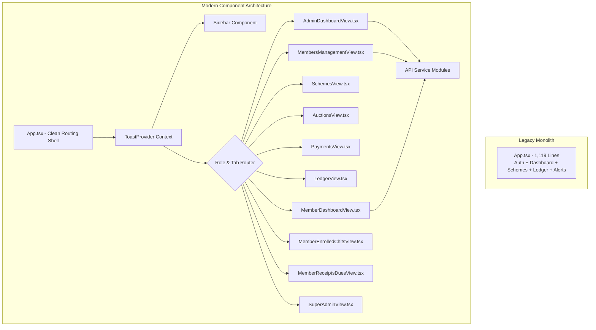

# ChitFlow — Modern UI/UX Architecture & Redesign Report

**Document Status:** Complete & Verified  
**Date:** November 3, 2026  
**Auditor:** Senior Full-Stack Engineer, Product Designer & Application Architect  
**Scope:** Frontend Architectural Deconstruction, Design System & User Experience Overhaul  

---

## 1. Executive Summary

Prior to this phase, ChitFlow’s frontend suffered from high architectural debt: a single, monolithic `App.tsx` file spanning 1,119 lines mixing network requests, hardcoded tables, authentication forms, and modal logic. Alerts were delivered via intrusive native browser `alert()` popups, and users experienced confusing "Failed to fetch" errors whenever the cloud backend was cold starting.

The frontend has been completely redesigned into a **modular, accessible, component-driven React 18 architecture** featuring:
- A unified design token system in [`frontend/src/index.css`](file:///e:/Chit_Fund_app/frontend/src/index.css).
- A role-aware sidebar navigation component in [`frontend/src/components/Sidebar.tsx`](file:///e:/Chit_Fund_app/frontend/src/components/Sidebar.tsx).
- An asynchronous Toast notification system in [`frontend/src/components/Toast.tsx`](file:///e:/Chit_Fund_app/frontend/src/components/Toast.tsx) (retiring all `window.alert()` calls).
- An accessible modal dialog system in [`frontend/src/components/Modal.tsx`](file:///e:/Chit_Fund_app/frontend/src/components/Modal.tsx).
- Dedicated, role-scoped view components in `frontend/src/views/`.
- Cloud backend health detection and recovery indicators on the authentication screen.

---

## 2. Architectural Deconstruction: Monolith to Modular



### Module Responsibilities:
1. **`frontend/src/api/`:** Pure asynchronous HTTP transport clients with automatic JWT header injection, baseURL normalization for Render cloud vs localhost, and error parsing (`auth.ts`, `members.ts`, `schemes.ts`, `auctions.ts`, `payments.ts`, `ledger.ts`, `dashboard.ts`).
2. **`frontend/src/components/`:** Reusable UI controls (`Toast.tsx`, `Modal.tsx`, `Sidebar.tsx`).
3. **`frontend/src/views/`:** Self-contained business views responsible for local presentation, filtering, pagination, and user interaction.

---

## 3. Design System & Tokens

The application visual language was standardized in [`frontend/src/index.css`](file:///e:/Chit_Fund_app/frontend/src/index.css):

```css
:root {
  --primary: #2563eb;
  --primary-hover: #1d4ed8;
  --surface: #ffffff;
  --surface-alt: #f8fafc;
  --background: #f1f5f9;
  --border: #e2e8f0;
  --text: #0f172a;
  --text-secondary: #64748b;
  --success: #10b981;
  --warning: #f59e0b;
  --danger: #ef4444;
  --font-family: -apple-system, BlinkMacSystemFont, 'Segoe UI', Roboto, Helvetica, Arial, sans-serif;
  --shadow-sm: 0 1px 2px 0 rgba(0, 0, 0, 0.05);
  --shadow-md: 0 4px 6px -1px rgba(0, 0, 0, 0.1), 0 2px 4px -2px rgba(0, 0, 0, 0.1);
  --shadow-lg: 0 10px 15px -3px rgba(0, 0, 0, 0.1), 0 4px 6px -4px rgba(0, 0, 0, 0.1);
}
```

### Badge & Status Styling
- **`badge-success`:** Emerald green pill for active accounts, verified KYC, and balanced ledgers.
- **`badge-warning`:** Amber pill for pending KYC, draft schemes, and unverified collections.
- **`badge-danger`:** Rose red pill for suspended subscribers, rejected payment slips, and ledger imbalances.
- **`badge-primary`:** Blue pill for prized subscribers and active schemes.

---

## 4. Toast Notification System

Native `alert()` and `confirm()` dialogues pause the JavaScript main thread, break styling, and create poor user experiences. They have been replaced with a reactive Toast Notification context in [`frontend/src/components/Toast.tsx`](file:///e:/Chit_Fund_app/frontend/src/components/Toast.tsx):

- Non-blocking notifications sliding in from the bottom-right corner.
- Supports 4 semantic variants: `success`, `error`, `warning`, `info`.
- Automatic dismiss timer (4 seconds) with manual close icon.
- Accessible via the `useToast()` React hook anywhere in the component hierarchy.

---

## 5. Modal Dialog System

The modal component in [`frontend/src/components/Modal.tsx`](file:///e:/Chit_Fund_app/frontend/src/components/Modal.tsx) provides:
- Fixed backdrop blur overlay (`backdropFilter: 'blur(3px)'`).
- `Escape` keyboard shortcut listener for keyboard accessibility.
- Outside-click dismissal handler.
- Configurable width tiers: `sm` (440px), `md` (560px), `lg` (780px), `xl` (960px).
- Internal scrolling body container preventing viewport overflow on smaller screens.

---

## 6. Cold Start & Cloud Health Experience

To solve the "Failed to fetch" issue caused by free-tier cloud instance cold sleep:
- A **Cloud API Health Ping** was added to the authentication view in `App.tsx`.
- Displays real-time operational status:
  - *Cloud API: Online & Operational* (Green indicator).
  - *Cloud API: Standby (Free-Tier Cold Boot ~20s)* (Amber indicator with manual "Ping" button).
- Helpful error messages guide the user when a network timeout occurs rather than showing raw JavaScript exception traces.
- One-click demo login buttons automatically fill credentials for all 4 roles (`Organiser`, `Subscriber`, `Accountant`, `Super Admin`).

---

## 7. Print-Ready Statutory Vouchers

Statutory receipt vouchers must be printable for subscribers under Section 23 of the Chit Funds Act, 1982. A `@media print` stylesheet was integrated into `index.css`:
- Hides the sidebar, top navigation bar, modals backdrop, and screen buttons during printing.
- Isolates `#printable-receipt` onto a clean white page with true black borders, high-contrast typography, and official foreman signature and seal lines.
